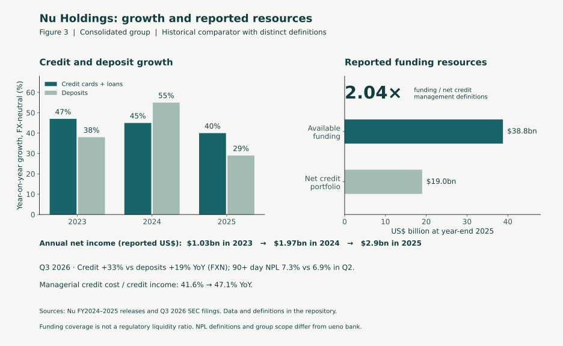

# Nubank: an informative comparator, with limits

The article uses Nu Holdings as a regional digital-finance example of rapid credit expansion accompanied by reported earnings and financial resources. It does not claim a perfectly matched control, causal proof of good management, a risk-free bank or a ranking against ueno.

Run `python3 comparator.py`, then `python3 plot_comparator.py` with the optional plotting dependency installed. The observations are in [data/nu_comparator.csv](data/nu_comparator.csv); publication dates, locations and original primary-source URLs are in [data/nu_sources.json](data/nu_sources.json). The information cutoff remains 12 November 2026, including Nu's Q3 2026 releases that day. Source reports are linked, not republished.

## What the evidence supports

Nu reported credit-card and loan portfolio growth of 47%, 45% and 40% in 2023–2025, on an FX-neutral basis. Reported full-year net income was US$1.0306bn, US$1.9721bn and approximately US$2.9bn, respectively. The FY2025 release reports US$38.8bn available funding against US$19.0bn net credit portfolio: 2.04 times, calculated from rounded published balances. It also reports US$2.2bn excess capital in operating entities. Parent cash is not added to this figure or assumed freely transferable across jurisdictions.

These observations suggest questions a growth plan should answer: can earnings support risk expansion, what funding remains usable, and where does capital sit? They do not establish why the bank achieved those outcomes or prove how it would perform in an adverse scenario.

## Comparability and definitions

- Nu is a consolidated group with different jurisdictions and products; ueno's 46.4% is a reported gross-loan growth observation for one Paraguayan bank. Nu's reported FX-neutral rates are indicative of a similar order of growth, not a harmonised cross-bank comparison. Never derive those rates from successive nominal USD balances.
- Available funding and net credit are management-defined amounts. Nu's presentation defines available funding as deposits less compulsory deposits plus financial bills; net credit nets credit-card-network payables from credit-card receivables and loans. Coverage is not cash, an LCR, an NSFR or a liquidity survival horizon, and is not compared directly with ueno's gross loans/customer deposits.
- Nu's reported 90+ day NPL stock and ueno's 60-day NPL observation differ in scope, classification, dates and portfolio mix. Figure 3 therefore does not place them on the same risk axis. Nu's current presentation refers to all geographies on the total-portfolio chart, while its glossary describes consumer credit excluding SMEs. Preserve the disclosed series and scope notes rather than splicing it into earlier Brazil-only disclosures.
- Full-year reported net income is used. Nu's FY2025 managerial presentation reorganises revenue/cost categories while preserving net income; those revenue/cost series are not spliced into this comparison. The Q3 ratios use the Q3 2026 release's comparable managerial presentation for Q3 2025 and Q3 2026. FY2025 net income has the source's rounded precision.
- A favourable historical example can invite hindsight and survivor bias. The selection is illustrative, not a representative sample of digital banks. Controls, underwriting quality and execution would require further evidence.

## Q3 2026: additional observations and their limits

All Q3 figures below come from the Q3 2026 release (`NU_Q326`) except Q3 2025 credit growth (`NU_Q325`); ratios are computed in `comparator.py` from same-basis observations only. Some are supplementary to the final article. They describe reported growth, funding and earnings composition without ranking the two banks or establishing a causal explanation of their outcomes.

- Credit grew 33% YoY against deposits at 19%, both FX-neutral; credit growth was 42% a year earlier. Reported 90+ day NPL rose from 6.7% in Q3 2025 and 6.9% in Q2 2026 to 7.3%.
- Total portfolio to deposits rose from 78.4% to 87.6% in a year. Card receivables are partly funded by payables to card networks, so this is a direction-of-travel indicator, not a loans/deposits or regulatory liquidity ratio.
- Managerial cost of credit / credit income rose from 41.6% to 47.1%. This is a descriptive change in the credit-cost burden, not evidence of a future pricing-loss path.
- IFRS ECL expense of US$1,668.5m compares with IFRS profit before tax of US$1,350.3m. Increasing only that quarter's ECL expense by about 81% eliminates pre-tax profit, with all other income and expenses fixed. The allowance stock covered 234% of 90+ NPLs; that stock measure is distinct from the ECL expense flow.
- Credit income was 60.6% of managerial revenue. This revenue category does not by itself identify customer versus intragroup earnings or make different consolidation scopes comparable.

Slowing growth and a rising 90+ ratio are compatible with the seasoning mechanism illustrated by the synthetic cohort model. The model is not calibrated to Nu and cannot attribute its observed NPL change to seasoning; Nu also reports deliberate underwriting expansions (`NU_Q326_PRESENTATION`, NPL bridge). Comparable vintage data are needed to distinguish the drivers. The comparator is not an assurance of continuing resilience.

The script checks source dates, duplicate observations, units, growth basis and metric scope before performing arithmetic. These checks establish internal data consistency, not an audit of issuer disclosures or an empirical validation of the synthetic ueno diagnostics.

## Quarterly earnings: two explicitly separate bases

The expanded article uses `data/nu_quarterly_financials.csv` and `earnings_sensitivity.py`. Q3 2026 IFRS ECL expense is US$1,668.5m and IFRS pre-tax profit US$1,350.3m. Under a frozen-quarter sensitivity, an additional ECL expense equal to that pre-tax profit eliminates it: approximately 80.93% of the starting ECL expense. Every other income and expense stays fixed. This does not model tax, future earnings, liquidity, capital or RWA responses and is not a bank survival test.

Separately, the current SEC release's comparable managerial cost of credit / credit income is 1,035.8 / 2,489.2 = 41.61% for Q3 2025 and 1,788.7 / 3,795.1 = 47.13% for Q3 2026. This ratio is descriptive; its two observations do not identify a future pricing-loss path. Managerial cost of credit is not substituted for IFRS ECL expense.

Read [METHODOLOGY.md](METHODOLOGY.md) for the full evidence framework, including the distinction between allowance stocks, expense flows, realised losses and capital. `validate_earnings.py` checks the break-even identity and rejects mixed accounting bases. The executed notebook includes both calculations and their checks.

The overlapping quarterly observations in `data/nu_comparator.csv` and `data/nu_quarterly_financials.csv` must agree on values, periods, scope, units and source. The comparator's same-basis ratios and the separate earnings sensitivity reproduce the same credit-cost ratios and IFRS break-even identity; they are not independent estimates or additive buffers.
