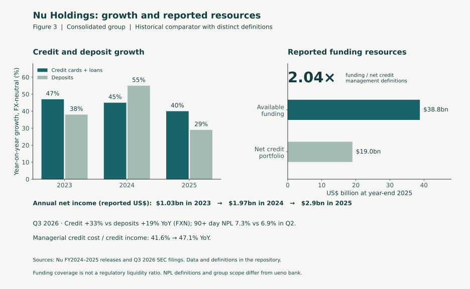
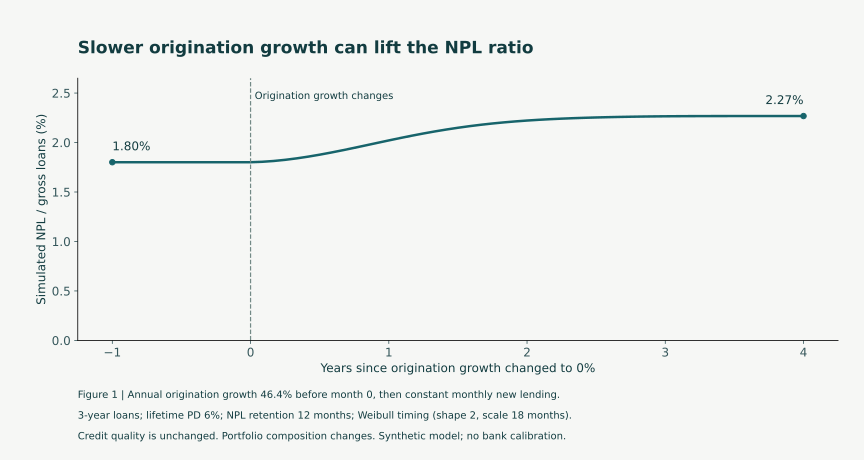
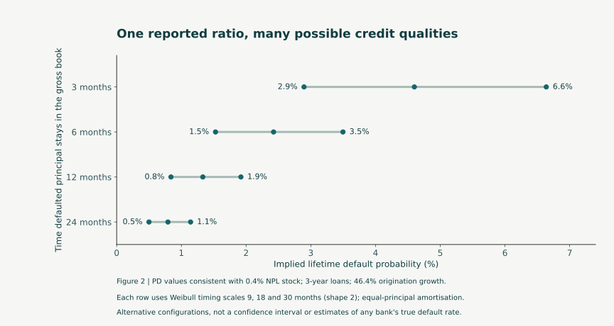
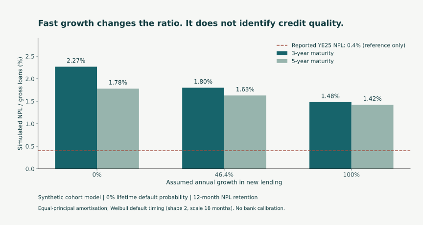
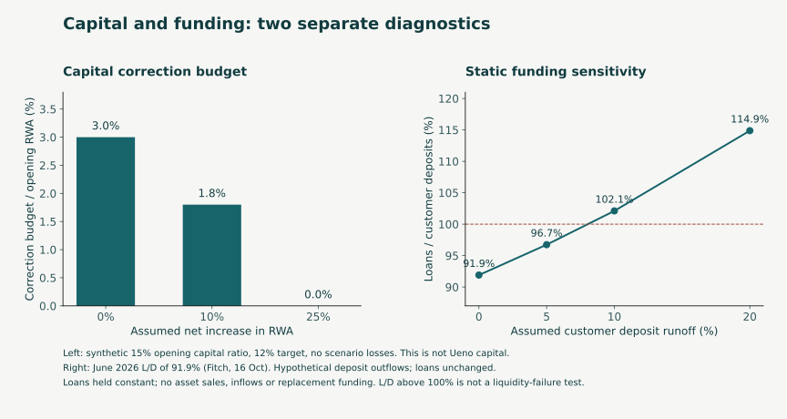

# ueno bank: the stress test before the stress test

Reproducible diagnostics by **Dr. Jairo Andrés Socarrás Fernández**. Public-information cutoff: **12 November 2026**.

This repository accompanies a LinkedIn article examining the opening balance sheet, interpretation of reported loan delinquency, and funding sensitivities. It contains independent calculations and synthetic models. It does **not** reconstruct ueno bank's regulatory capital, loan book or liquidity position, and does not estimate a probability of failure.

## Reproduce the calculations

Python 3.10+; no third-party dependencies for the core calculations:

```sh
python3 analysis.py
python3 validate.py
```

The first command generates CSV tables and `results/summary.json`. The second compares all **324 cohort specifications** with an independent time-forward ledger and checks the reverse-default-probability calculations. `VALIDATION.txt` records the results.

For the charts, install the optional plotting dependency and run:

```sh
python3 -m pip install -r requirements-plot.txt
python3 plot_results.py
```

Plotting was tested with matplotlib 3.9.2. `Ueno_analysis.ipynb` includes executed code, captured outputs and links to the versioned figures for inspection without rerunning the notebook. Running it assumes the notebook's working directory is this repository's root.

### Comparative case: Nubank

The article now includes a short historical comparator, with sourced observations separated from the synthetic models. Nu reported FX-neutral credit-card and loan growth of 47%, 45% and 40% in 2023–2025, alongside annual profits and reported funding/capital resources. Its latest Q3 2026 disclosure also shows higher 90+ day NPLs and credit growth exceeding deposit growth. This is an informative example with explicit limits, not a matched control or proof of future safety.

```sh
python3 comparator.py
python3 plot_comparator.py
```

The first command uses only the standard library. The second uses the same optional plotting dependency as the existing figures. [COMPARATOR.md](COMPARATOR.md) explains metric scope, FX neutrality, funding definitions and selection limits; [data/nu_sources.json](data/nu_sources.json) links every primary source. The inputs and derived arithmetic are versioned separately. No cross-bank NPL or liquidity-ratio ranking is made.



### Article revision: growth that the balance sheet can support

The revised article adds two explicitly reproducible numbered figures and a capital-only growth budget. Run the same commands above; no additional dependencies are needed for the calculations.

- **Figure 1:** `cohort_transition()` changes annual origination growth from 46.4% to 0% at month zero. New monthly lending then stays constant; existing loans amortise and new loans continue to enter. Credit quality is unchanged, while the age mix changes. `results/growth_transition.csv` records 61 monthly observations. About 90.2% of the eventual NPL-ratio rise occurs within 24 months in this synthetic configuration.
- **Figure 2:** `results/non_identification.csv` supplies the twelve inverse-PD solutions, rendered by `plot_results.py` as `figures/figure_2_non_identification.svg`.
- **Growth budget:** `growth_capacity()` evaluates `(capital + net retained earnings + new capital - opening corrections - other incremental losses) / (management target × opening RWA) - 1`. Retained earnings are net of tax, dividends and losses already included, so incremental losses must not be counted twice. The output is RWA growth capacity under the capital constraint alone, not loan-origination growth, a forecast or a safe-growth recommendation.

For capital 15, opening RWA 100, net retained earnings 1.5, no new capital and a **synthetic management target of 15%**, capital-only RWA growth capacity is 10%. An opening correction of 1 lowers it to 3.33%; a correction of 2 produces negative capacity (-3.33%), signalling a shortfall against the chosen target. The management target is distinct from the general regulatory minimum discussed in the article.





The independent ledger now verifies all 61 transition observations as well as the original 324 configurations. Capital-budget identities and transition limiting cases are included in the seven automated model checks. No empirical validation of bank-specific behaviour is claimed.

The article's proposed growth process uses capital, funding, vintage performance and operating capacity as constraints on a business plan. Suggested references are the Basel Committee's [capital planning guidance](https://www.bis.org/committees/bcbs/basel-consolidated-guidelines/module/cad/10) and [liquidity risk management guidance](https://www.bis.org/committees/bcbs/basel-consolidated-guidelines/module/lqy/10). These are international reference practices, not a statement of institution-specific legal obligations.

## What is calculated?

| Diagnostic | Input and assumptions | What the result means |
|---|---|---|
| Capital correction budget | Synthetic capital of 15 and opening RWA of 100; a 12% target; net RWA changes specified externally | A transparent reverse sensitivity. No conversion between accounting equity, Fitch Core Capital and regulatory capital is assumed. |
| Cohort NPL stock | Equal-principal monthly loan cohorts; varying maturity, lifetime default probability, default timing, retention of defaulted principal and origination growth | A controlled mechanism study. The observed NPL reference is not used to calibrate an actual bank portfolio. |
| Reverse PD calculation | Twelve timing/retention configurations, three-year maturity and 46.4% origination growth; solve for PD compatible with a 0.4% stock ratio | Alternative model configurations, not a confidence interval or estimates of ueno's credit quality. |
| Deposit-runoff sensitivity | Historical June 2026 loans/deposits ratio of 91.9%, from Fitch's October report; loans constant, deposits reduced | Static funding arithmetic. Excludes replacement funding, asset sales, inflows, encumbrance and currency mismatches. Crossing 100% is not a liquidity-failure threshold. |

### Selected outputs

With 6% lifetime default probability, a 36-month term, 12-month default retention and Weibull default timing (shape 2; scale 18 months), the model produces NPL stocks of **2.27%, 1.80% and 1.48%** at annual origination growth of 0%, 46.4% and 100%, respectively. Other configurations change the magnitude and sometimes the direction of the growth effect.





## Important interpretation limits

- The published 46.4% figure is growth in **gross loans**. Mapping it to a stable origination-growth regime is a controlled illustration, not a historical fit.
- Synthetic defaults enter the NPL stock immediately. The model does not implement the report's **60-day past-due** classification lag. It also omits acquisitions, regulatory deferrals, prepayments and partial recoveries.
- Defaulted principal is frozen at the start-of-default-month exposure and exits after the chosen retention window. This exit assumption is not a recovery-rate estimate.
- The 324 combinations are deterministic sensitivities, not stochastic paths, independent observations or an empirical probability distribution. No random seed is required.
- RWA changes in the capital calculation are **net** changes and are not inferred from ueno's accounts. Tax, earnings and management actions are excluded.
- Fitch Core Capital, accounting equity and regulatory capital have different definitions. The reported 2025 ratio difference after deducting intangibles must not be interpreted as a measured capital loss occurring between publication dates.
- Numerical validation establishes implementation consistency. It does not validate these assumptions against a bank's internal data.

## Public sources and observation dates

| Source | Used for |
|---|---|
| [BCP resolution announcement, 3 November 2026](https://www.bcp.gov.py/web/institucional/w/banco-central-inicia-el-procedimiento-de-resolucion-de-ueno-bank) | Official description of the resolution trigger following statement adjustments |
| [Fitch report, 2 March 2026](https://www.ueno.com.py/wp-content/uploads/2026/03/Ueno_Bank_Full-Rating-Report_Mar.2026.pdf) | Year-end 2025 loan growth, NPL definition and historical reported capital ratio |
| [Fitch report, 16 October 2026; issuer-hosted copy](https://www.ueno.com.py/inversores/wp-content/uploads/sites/3/2026/10/Risk-Rating-Report-%E2%80%93-Fitch-Ratings-%E2%80%93-October-2026.pdf) | Adjusted capital definition and June 2026 loans/deposits ratio |
| [BCP Financial Stability Report, May 2026](https://www.bcp.gov.py/en/web/institucional/w/informe-de-estabilidad-financiera-mayo-2026) | Context for the general total regulatory capital minimum |
| [Basel Committee stress-testing principles, RMA30](https://www.bis.org/committees/bcbs/basel-consolidated-guidelines/module/rma/30) | Data quality, granularity and acquisition-data integration as reference principles |

Only original code, synthetic calculations and derived outputs are included. No internal bank or employer data, private correspondence, unpublished editorial review or third-party report copies are included.

Personal research and views; they do not represent the author's employer. This material is an analytical illustration, not an investment recommendation or a finding about unlawful conduct.
